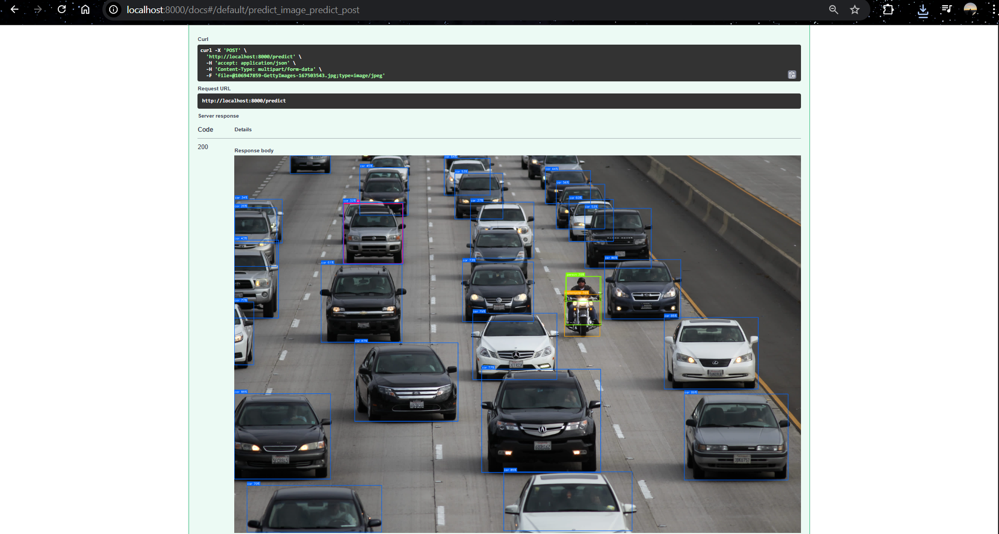
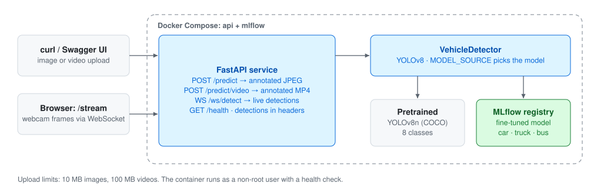
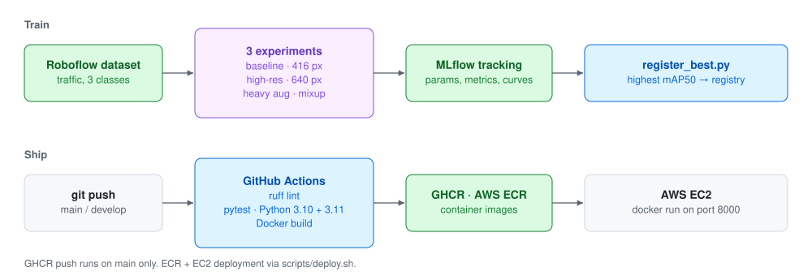
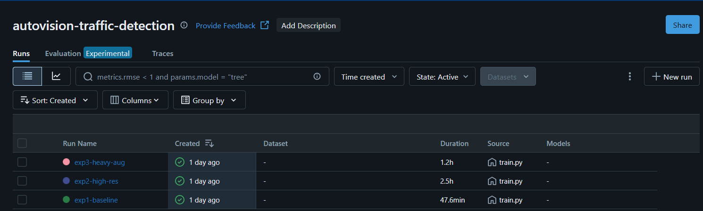
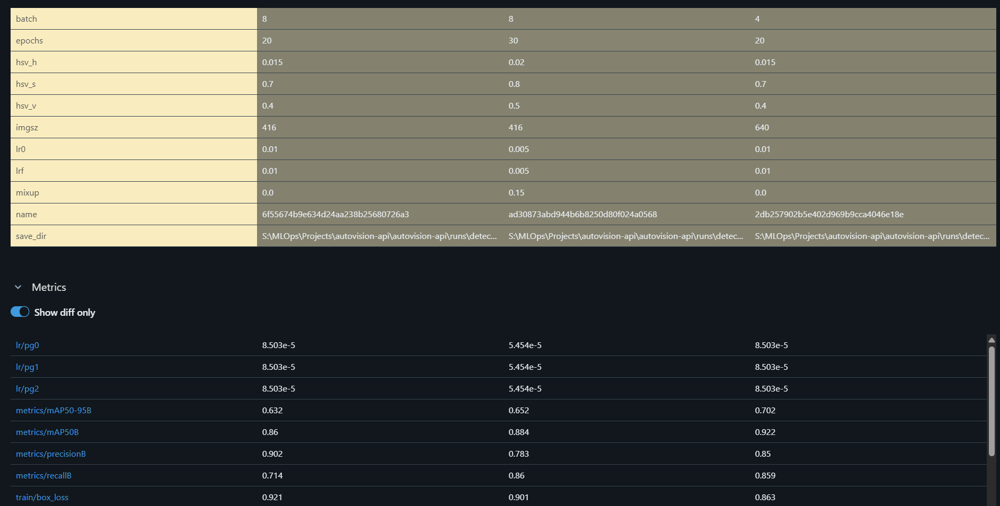
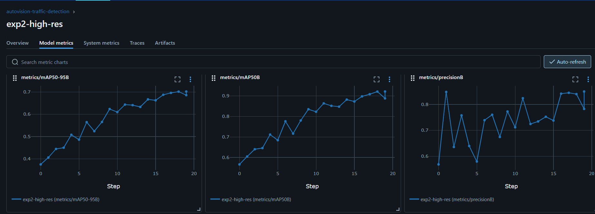
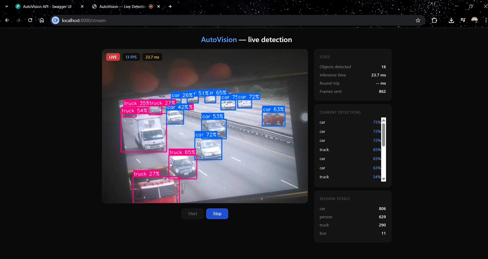
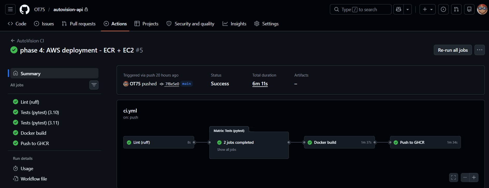
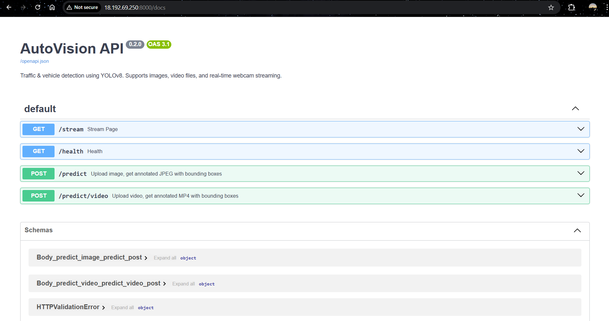
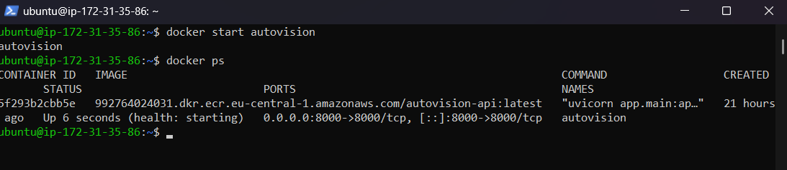

# AutoVision API

**Traffic and vehicle detection as a production-style ML service.**
A YOLOv8 model behind a FastAPI service that detects vehicles in images, videos and a live webcam stream. Fine-tuned on traffic data with every experiment tracked in MLflow, tested and built in CI, containerised, and deployed to AWS.

[](https://github.com/OT75/autovision-api/actions/workflows/ci.yml)




**At a glance**

- **Serves** images, videos and a real-time WebSocket webcam stream, with detections returned in response headers
- **Fine-tuned** YOLOv8n in 3 tracked experiments; the best reached **0.922 mAP50** (up from 0.860 for the baseline) and was registered in the MLflow Model Registry
- **Tested** with 32 pytest tests on Python 3.10 and 3.11, in a 4-stage GitHub Actions pipeline (lint → test → build → publish)
- **Deployed** as a container to AWS (ECR + EC2)

---

## Contents

- [Why this project](#why-this-project)
- [Architecture](#architecture)
- [Fine-tuning results](#fine-tuning-results)
- [Quick start](#quick-start)
- [API](#api)
- [Training your own model](#training-your-own-model)
- [Tests and CI/CD](#tests-and-cicd)
- [AWS deployment](#aws-deployment)
- [Project structure](#project-structure)
- [Limitations and next steps](#limitations-and-next-steps)

## Why this project

Training a detector in a notebook is the easy part. This project covers the rest of the lifecycle around a model: serving it behind an API, tracking which experiment produced which model, choosing and registering the best one by a metric instead of by hand, testing the service without needing model weights, and shipping it as a container to the cloud.

## Architecture

### Serving

<picture>
  <source media="(prefers-color-scheme: dark)" srcset="docs/diagrams/serving-architecture-dark.svg">
  
</picture>

- **One detector, two model sources.** `MODEL_SOURCE=local` loads pretrained YOLOv8n (COCO, filtered to 8 traffic-relevant classes); `MODEL_SOURCE=mlflow` loads the fine-tuned model (car, truck, bus) from the MLflow Model Registry. Switching is a configuration change, not a code change.
- **Annotated media plus structured data.** `/predict` returns the annotated JPEG and the detections as JSON in an `X-Detections` header; `/predict/video` returns an MP4 with an `X-Summary` header.
- **Real time over WebSocket.** The `/stream` page sends webcam frames to `/ws/detect` and shows boxes, FPS, inference time and running totals per class.
- **Hardened container:** multi-stage build, non-root user, health check, and upload limits (10 MB images, 100 MB videos).

### Model lifecycle

<picture>
  <source media="(prefers-color-scheme: dark)" srcset="docs/diagrams/model-lifecycle-dark.svg">
  
</picture>

## Fine-tuning results

Three experiments on a Roboflow traffic dataset (3 classes: car, truck, bus), each changing one idea, all tracked in MLflow:

| Experiment | Setup | mAP50 | mAP50-95 | Precision | Recall | Training time |
|---|---|---|---|---|---|---|
| `exp1-baseline` | 416 px, 20 epochs, LR 0.01 | 0.860 | 0.632 | **0.902** | 0.714 | 48 min |
| `exp2-high-res` | **640 px**, 20 epochs, batch 4 | **0.922** | **0.702** | 0.850 | 0.859 | 2.5 h |
| `exp3-heavy-aug` | 416 px, 30 epochs, LR 0.005, mixup 0.15 | 0.884 | 0.652 | 0.783 | **0.860** | 1.2 h |

**What the numbers say**

- **Resolution mattered most.** Going from 416 to 640 px raised mAP50 from 0.860 to 0.922. Vehicles further away are small objects, and they lose detail at lower resolution.
- **The baseline was precise but missed vehicles.** Its precision was the highest (0.902), but recall was only 0.714: it missed about 3 in 10 vehicles.
- **Heavy augmentation traded precision for recall.** Mixup and stronger colour jitter found more vehicles (recall 0.860) but with more false positives (precision 0.783).
- **The best model costs more.** `exp2-high-res` took about 3× longer to train than the baseline, and 640 px input is also slower at inference. For a traffic camera that's a reasonable trade; for an edge device it might not be.

`training/register_best.py` compares all runs by mAP50 and registers the winner, `exp2-high-res`, in the MLflow Model Registry, so the choice is reproducible rather than manual.

| Runs in MLflow | Side-by-side comparison |
|---|---|
|  |  |



## Quick start

Requires [Docker](https://www.docker.com/products/docker-desktop/).

```bash
git clone https://github.com/OT75/autovision-api.git
cd autovision-api
docker compose up --build
```

| What | URL |
|---|---|
| API documentation (Swagger) | http://localhost:8000/docs |
| Live webcam detection | http://localhost:8000/stream |
| MLflow UI | http://localhost:5000 |

Try it with any traffic photo:

```bash
curl -X POST -F "file=@traffic.jpg" http://localhost:8000/predict -o result.jpg -D headers.txt
```

`result.jpg` is the annotated image; `headers.txt` contains the detections in `X-Detections`.

Or open http://localhost:8000/stream for live detection from your webcam, with FPS, inference time and running totals per class:



## API

| Method | Endpoint | Description |
|---|---|---|
| `GET` | `/health` | Health check, including whether the model is loaded |
| `POST` | `/predict` | Upload an image (JPEG/PNG/WebP, max 10 MB) → annotated JPEG + `X-Detections` header |
| `POST` | `/predict/video` | Upload a video (MP4/AVI/WebM/MOV, max 100 MB) → annotated MP4 + `X-Summary` header |
| `GET` | `/stream` | Live webcam detection page |
| `WS` | `/ws/detect` | WebSocket for real-time frame detection |

**Configuration** (environment variables, set in `docker-compose.yml`)

| Variable | Default | Description |
|---|---|---|
| `MODEL_SOURCE` | `local` | `local` = pretrained YOLOv8n, `mlflow` = fine-tuned model from the registry |
| `MODEL_NAME` | `yolov8n.pt` | Weights file for local mode |
| `CONFIDENCE_THRESHOLD` | `0.25` | Minimum confidence for a detection |
| `MLFLOW_TRACKING_URI` | `http://localhost:5000` | MLflow server (`http://mlflow:5000` inside Compose) |
| `MLFLOW_MODEL_NAME` | `autovision-traffic` | Registered model name |

## Training your own model

```bash
pip install -r requirements-training.txt

# 1. Start the MLflow tracking server
docker compose up mlflow                     # UI at http://localhost:5000

# 2. Download the dataset (free Roboflow API key)
python training/download_dataset.py --api-key YOUR_ROBOFLOW_KEY

# 3. Run the experiments
python training/train.py --config training/configs/exp1_baseline.yaml
python training/train.py --config training/configs/exp2_high_res.yaml
python training/train.py --config training/configs/exp3_heavy_aug.yaml

# 4. Register the best run by mAP50
python training/register_best.py
```

Then set `MODEL_SOURCE=mlflow` in `docker-compose.yml` and run `docker compose up --build` to serve the fine-tuned model.

Each experiment is one YAML file, so a new experiment is a config change, not a code change.

## Tests and CI/CD

```bash
pip install -r requirements-test.txt
pytest --cov=app -v
```

**32 tests** in four groups: health, image prediction, video prediction and API structure. The detector is **mocked**, so the tests check the service's behaviour (validation, size limits, response formats, headers) without downloading model weights, and run in seconds.

GitHub Actions runs on every push to `main` and `develop`:

| Stage | What it does |
|---|---|
| Lint | `ruff check app/ tests/` |
| Tests | pytest on Python **3.10 and 3.11** (matrix), with coverage |
| Docker build | Proves the multi-stage Dockerfile builds |
| Publish | Pushes the image to GitHub Container Registry (on `main` only) |



## AWS deployment

```bash
# Requires the AWS CLI and AWS_ACCOUNT_ID
export AWS_ACCOUNT_ID=your_account_id
./scripts/deploy.sh
```

The script builds the image and pushes it to **Amazon ECR** (eu-central-1). On an **EC2** instance:

```bash
docker pull <ECR_URI>/autovision-api:latest
docker run -d --name autovision -p 8000:8000 <ECR_URI>/autovision-api:latest
```

| API running on EC2 | Container on the instance |
|---|---|
|  |  |

More screenshots of every phase are in [`docs/img/`](docs/img), and the full write-up is in [`DOCUMENTATION.html`](DOCUMENTATION.html) (download it together with the `docs/` folder and open it in a browser).

## Project structure

```
autovision-api/
├── app/
│   ├── main.py              # FastAPI: health, image and video endpoints
│   ├── model.py             # VehicleDetector: local or MLflow model loading
│   ├── schemas.py           # Pydantic response models
│   ├── stream.py            # WebSocket endpoint and /stream page
│   └── templates/stream.html
├── training/
│   ├── download_dataset.py  # pull the dataset from Roboflow
│   ├── train.py             # train YOLOv8 with MLflow tracking
│   ├── register_best.py     # compare runs, register the best
│   └── configs/             # one YAML per experiment
├── tests/test_api.py        # 32 tests, detector mocked
├── scripts/deploy.sh        # build and push to AWS ECR
├── .github/workflows/ci.yml # lint → test → build → publish
├── Dockerfile               # multi-stage, non-root, health check
├── docker-compose.yml       # api + mlflow
└── docs/                    # screenshots and diagrams
```

## Limitations and next steps

- **Evaluated on the dataset's validation split only;** a held-out test set from different cameras would show how well it generalises.
- **Three experiments** is a small search. Next: a larger model (YOLOv8s), longer training at 640 px, and combining high resolution with moderate augmentation.
- **Inference speed isn't benchmarked** per configuration yet; that matters for choosing between 416 and 640 px.
- **Deployment is manual** (script + `docker run`). Next: deploy automatically from CI, put HTTPS in front, and add monitoring (latency, errors, detections per class).
- **The model is loaded once at startup;** reloading a newly registered model would require a restart.

## License

[MIT](LICENSE)
